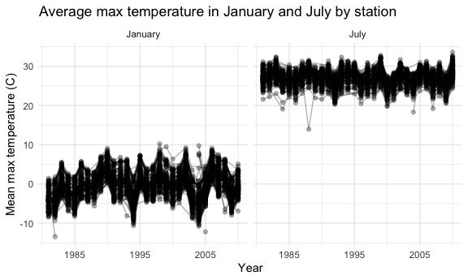
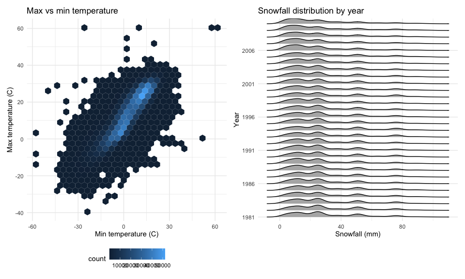
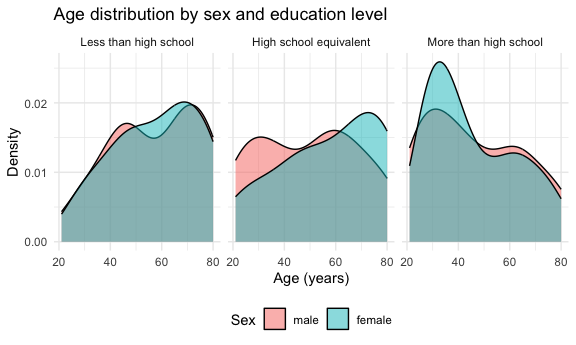
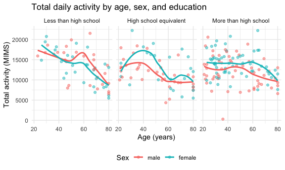
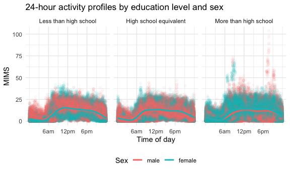
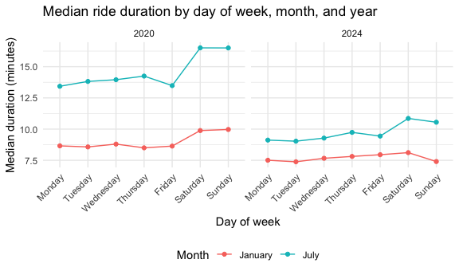
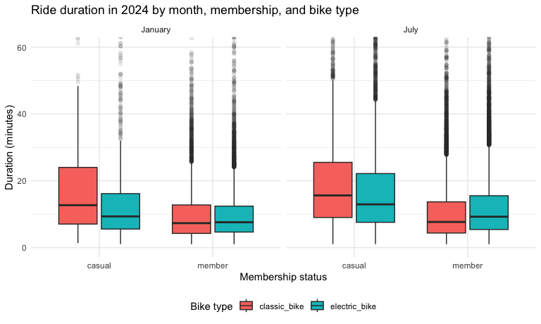

P8105 Homework 3
================
Meher Walia
2026-10-14

``` r
library(tidyverse)
library(p8105.datasets)
library(ggridges)
library(patchwork)

knitr::opts_chunk$set(
  fig.width = 6,
  fig.asp = .6,
  out.width = "90%"
)

theme_set(theme_minimal() + theme(legend.position = "bottom"))
```

## Problem 1

``` r
data("ny_noaa")

ny_noaa_df = 
  ny_noaa |> 
  separate(date, into = c("year", "month", "day"), sep = "-") |> 
  mutate(
    across(c(year, month, day), as.integer),
    tmax = as.numeric(tmax) / 10,
    tmin = as.numeric(tmin) / 10,
    prcp = prcp / 10)
```

The `ny_noaa` dataset contains daily weather observations from 747
weather stations in New York State between 1981 and 2010, with 2595176
observations of 7 variables in the raw data. Each row is one station on
one day. The variables are a station `id`, the `date` of observation,
precipitation (`prcp`), snowfall (`snow`), snow depth (`snwd`), and
maximum and minimum temperature (`tmax` and `tmin`).

Missing data is a substantial issue. Temperature is missing for roughly
44% of observations, snow depth for about 23%, snowfall for about 15%,
and precipitation for about 6%; this likely reflects that not all
stations record all measurements. In cleaning, I separated `date` into
`year`, `month`, and `day`, converted temperatures from tenths of a
degree Celsius to degrees Celsius, and converted precipitation from
tenths of a millimeter to millimeters. Snowfall and snow depth are
already recorded in millimeters.

``` r
ny_noaa_df |> 
  count(snow) |> 
  arrange(desc(n)) |> 
  head(10)
```

    ## # A tibble: 10 × 2
    ##     snow       n
    ##    <int>   <int>
    ##  1     0 2008508
    ##  2    NA  381221
    ##  3    25   31022
    ##  4    13   23095
    ##  5    51   18274
    ##  6    76   10173
    ##  7     8    9962
    ##  8     5    9748
    ##  9    38    9197
    ## 10     3    8790

The most commonly observed snowfall value is 0, with over two million
observations. This makes sense because most days in New York State have
no snow at all; snowfall is only possible during winter months, so the
majority of days across the year record zero. The next most common
values after 0 and missing are 25, 13, 51, and 76 mm, which correspond
to 1, 0.5, 2, and 3 inches. This suggests measurements were originally
taken in inches and converted, so values cluster at whole and half-inch
increments.

``` r
ny_noaa_df |> 
  filter(month %in% c(1, 7)) |> 
  mutate(month = factor(month, levels = c(1, 7), labels = c("January", "July"))) |> 
  group_by(id, year, month) |> 
  summarize(mean_tmax = mean(tmax, na.rm = TRUE), .groups = "drop") |> 
  drop_na(mean_tmax) |> 
  ggplot(aes(x = year, y = mean_tmax, group = id)) + 
  geom_point(alpha = .3) + 
  geom_line(alpha = .3) + 
  facet_grid(. ~ month) + 
  scale_x_continuous(breaks = c(1985, 1995, 2005)) + 
  labs(
    title = "Average max temperature in January and July by station",
    x = "Year",
    y = "Mean max temperature (C)")
```



January and July temperatures occupy entirely separate ranges, with
January station means mostly between -10 and 10°C and July means mostly
between 20 and 30°C. Within each panel, stations move together from year
to year: a cold January is cold across nearly all stations at once,
reflecting weather systems that affect the whole state. There is
substantial year-to-year variability but no obvious warming trend across
this 30-year window.

A few outliers stand out. In January, one station recorded a mean near
-13°C in the early 1980s and another near -12°C around 2004. In July,
one station recorded a mean near 14°C around 1988, well below every
other July observation, which likely reflects a recording error or an
unusual station.

``` r
tmax_tmin_plot = 
  ny_noaa_df |> 
  drop_na(tmax, tmin) |> 
  ggplot(aes(x = tmin, y = tmax)) + 
  geom_hex() + 
  labs(
    title = "Max vs min temperature",
    x = "Min temperature (C)",
    y = "Max temperature (C)")

snow_plot = 
  ny_noaa_df |> 
  filter(snow > 0, snow < 100) |> 
  ggplot(aes(x = snow, y = as.factor(year))) + 
  geom_density_ridges(scale = .85) + 
  scale_y_discrete(breaks = seq(1981, 2010, by = 5)) + 
  labs(
    title = "Snowfall distribution by year",
    x = "Snowfall (mm)",
    y = "Year")

tmax_tmin_plot + snow_plot
```

    ## Picking joint bandwidth of 3.76



The hexbin plot shows a strong positive linear relationship between
daily minimum and maximum temperature, with most observations
concentrated along a band from roughly -10°C to 30°C. A scatterplot
would be ineffective here because 1.4 million points would overplot into
a solid mass; binning shows where the data actually concentrate. A
handful of implausible observations sit well off the main band,
including points near 60°C and -40°C, which are likely recording errors.

The snowfall distributions are stable across the thirty years, with no
apparent trend. Each year shows the same multimodal shape, with peaks at
roughly 25, 50, and 76 mm, again the 1-, 2-, and 3-inch values,
reflecting that measurements were recorded in inches and converted.

## Problem 2

``` r
nhanes_demo = 
  read_csv("./data/nhanes_covar.csv", skip = 4) |> 
  janitor::clean_names() |> 
  filter(age >= 21) |> 
  drop_na() |> 
  mutate(
    sex = factor(sex, levels = c(1, 2), labels = c("male", "female")),
    education = factor(
      education,
      levels = c(1, 2, 3),
      labels = c("Less than high school", "High school equivalent", "More than high school")))
```

    ## Rows: 250 Columns: 5
    ## ── Column specification ────────────────────────────────────────────────────────
    ## Delimiter: ","
    ## dbl (5): SEQN, sex, age, BMI, education
    ## 
    ## ℹ Use `spec()` to retrieve the full column specification for this data.
    ## ℹ Specify the column types or set `show_col_types = FALSE` to quiet this message.

``` r
nhanes_accel = 
  read_csv("./data/nhanes_accel.csv") |> 
  janitor::clean_names() |> 
  pivot_longer(
    min1:min1440,
    names_to = "minute",
    names_prefix = "min",
    values_to = "mims") |> 
  mutate(minute = as.numeric(minute))
```

    ## Rows: 250 Columns: 1441
    ## ── Column specification ────────────────────────────────────────────────────────
    ## Delimiter: ","
    ## dbl (1441): SEQN, min1, min2, min3, min4, min5, min6, min7, min8, min9, min1...
    ## 
    ## ℹ Use `spec()` to retrieve the full column specification for this data.
    ## ℹ Specify the column types or set `show_col_types = FALSE` to quiet this message.

``` r
nhanes_df = 
  inner_join(nhanes_demo, nhanes_accel, by = "seqn")
```

The demographic file begins with four rows of codebook notes, so I
skipped those when importing. I excluded participants under 21 and those
with missing demographic data, which leaves 228 participants. Sex and
education were stored as numeric codes, so I converted both to factors
with informative labels, ordering education from least to most. The
accelerometer file stores one column per minute of the day, which is not
tidy; I pivoted these into a `minute` variable and a `mims` variable so
each row is one minute of observation for one participant. Joining the
two gives 328,320 rows.

``` r
nhanes_demo |> 
  count(education, sex) |> 
  pivot_wider(names_from = sex, values_from = n) |> 
  knitr::kable()
```

| education              | male | female |
|:-----------------------|-----:|-------:|
| Less than high school  |   27 |     28 |
| High school equivalent |   35 |     23 |
| More than high school  |   56 |     59 |

``` r
nhanes_demo |> 
  ggplot(aes(x = age, fill = sex)) + 
  geom_density(alpha = .5) + 
  facet_grid(. ~ education) + 
  labs(
    title = "Age distribution by sex and education level",
    x = "Age (years)",
    y = "Density",
    fill = "Sex")
```



The More than high school category is the largest, with 115
participants, and is roughly balanced between men and women. The Less
than high school group is also balanced, while the High school
equivalent group has noticeably more men than women (35 versus 23).

The age distributions differ by education level. Participants with less
than a high school education are concentrated at older ages, peaking
near 70, and men and women have similar distributions. In the high
school equivalent group, men skew younger than women, with a male peak
near 30 and a female peak near 70. Among participants with more than a
high school education, both sexes are younger overall, with a pronounced
peak near age 30 that is stronger for women.

``` r
nhanes_df |> 
  group_by(seqn, sex, age, education) |> 
  summarize(total_activity = sum(mims), .groups = "drop") |> 
  ggplot(aes(x = age, y = total_activity, color = sex)) + 
  geom_point(alpha = .5) + 
  geom_smooth(se = FALSE) + 
  facet_grid(. ~ education) + 
  labs(
    title = "Total daily activity by age, sex, and education",
    x = "Age (years)",
    y = "Total activity (MIMS)",
    color = "Sex")
```

    ## `geom_smooth()` using method = 'loess' and formula = 'y ~ x'



Total daily activity declines with age across all three education
levels, though the shape of that decline differs. Among participants
with less than a high school education, activity falls fairly steadily
from roughly 17,000 MIMS in the twenties to about 9,000 by age 80, with
men and women following similar trajectories. In the high school
equivalent group, activity peaks in the thirties and forties, especially
for women, who reach about 17,000 MIMS near age 40, before dropping
sharply after 60. Among those with more than a high school education,
activity stays relatively flat from the twenties through the fifties
before declining, and women are consistently more active than men across
most of the age range.

One participant in the More than high school group recorded total
activity near zero, which likely reflects a device malfunction or
non-wear rather than genuine inactivity.

``` r
nhanes_df |> 
  ggplot(aes(x = minute, y = mims, color = sex)) + 
  geom_point(alpha = .05) + 
  geom_smooth(se = FALSE) + 
  facet_grid(. ~ education) + 
  scale_x_continuous(breaks = c(360, 720, 1080), labels = c("6am", "12pm", "6pm")) + 
  labs(
    title = "24-hour activity profiles by education level and sex",
    x = "Time of day",
    y = "MIMS",
    color = "Sex")
```

    ## `geom_smooth()` using method = 'gam' and formula = 'y ~ s(x, bs = "cs")'



All three education levels show the same basic circadian pattern:
activity is near zero overnight, rises steeply between about 5am and
8am, plateaus through the day, and falls off after about 8pm. The
overnight trough and daytime plateau are consistent across groups, which
is expected since sleep and waking hours do not vary much by education.

The differences between groups are in the level and shape of the daytime
plateau. Participants with less than a high school education show a
distinct midday peak around noon, with women more active than men for
most of the day. In the high school equivalent group, the daytime
profile is flatter and the two sexes track each other closely. Among
participants with more than a high school education, the plateau is
sustained later into the evening, and this group shows the highest peak
values overall, with some observations above 75 MIMS that do not appear
in the other panels.

## Problem 3

``` r
citibike_df = 
  bind_rows(
    read_csv("./data/citibike/Jan 2020 Citi.csv") |> mutate(year = 2020, month = "January"),
    read_csv("./data/citibike/July 2020 Citi.csv") |> mutate(year = 2020, month = "July"),
    read_csv("./data/citibike/Jan 2024 Citi.csv") |> mutate(year = 2024, month = "January"),
    read_csv("./data/citibike/July 2024 Citi.csv") |> mutate(year = 2024, month = "July")) |> 
  janitor::clean_names() |> 
  mutate(
    month = factor(month, levels = c("January", "July")),
    weekdays = factor(
      weekdays,
      levels = c("Monday", "Tuesday", "Wednesday", "Thursday", "Friday", "Saturday", "Sunday")),
    member_casual = factor(member_casual),
    rideable_type = factor(rideable_type)) |> 
  relocate(year, month)
```

    ## Rows: 12420 Columns: 7
    ## ── Column specification ────────────────────────────────────────────────────────
    ## Delimiter: ","
    ## chr (6): ride_id, rideable_type, weekdays, start_station_name, end_station_n...
    ## dbl (1): duration
    ## 
    ## ℹ Use `spec()` to retrieve the full column specification for this data.
    ## ℹ Specify the column types or set `show_col_types = FALSE` to quiet this message.
    ## Rows: 21048 Columns: 7
    ## ── Column specification ────────────────────────────────────────────────────────
    ## Delimiter: ","
    ## chr (6): ride_id, rideable_type, weekdays, start_station_name, end_station_n...
    ## dbl (1): duration
    ## 
    ## ℹ Use `spec()` to retrieve the full column specification for this data.
    ## ℹ Specify the column types or set `show_col_types = FALSE` to quiet this message.
    ## Rows: 18861 Columns: 7
    ## ── Column specification ────────────────────────────────────────────────────────
    ## Delimiter: ","
    ## chr (6): ride_id, rideable_type, weekdays, start_station_name, end_station_n...
    ## dbl (1): duration
    ## 
    ## ℹ Use `spec()` to retrieve the full column specification for this data.
    ## ℹ Specify the column types or set `show_col_types = FALSE` to quiet this message.
    ## Rows: 47156 Columns: 7
    ## ── Column specification ────────────────────────────────────────────────────────
    ## Delimiter: ","
    ## chr (6): ride_id, rideable_type, weekdays, start_station_name, end_station_n...
    ## dbl (1): duration
    ## 
    ## ℹ Use `spec()` to retrieve the full column specification for this data.
    ## ℹ Specify the column types or set `show_col_types = FALSE` to quiet this message.

These data contain 99,485 Citi Bike rides, representing 1% of all rides
under four hours in January and July of 2020 and 2024. Each row is one
ride. The variables include a unique `ride_id`, the `rideable_type`
(classic or electric), the `weekdays` on which the ride occurred, the
ride `duration` in minutes, the start and end station names, and whether
the rider was a member or casual user. The four source files do not
include year or month as variables, so I added these when importing and
combined the files with `bind_rows`. I converted month, weekday,
membership status, and bike type to factors, ordering weekdays Monday
through Sunday so that tables and plots display in a sensible order.

``` r
citibike_df |> 
  group_by(year, month, member_casual) |> 
  summarize(n_rides = n(), .groups = "drop") |> 
  pivot_wider(names_from = member_casual, values_from = n_rides) |> 
  knitr::kable()
```

| year | month   | casual | member |
|-----:|:--------|-------:|-------:|
| 2020 | January |    984 |  11436 |
| 2020 | July    |   5637 |  15411 |
| 2024 | January |   2108 |  16753 |
| 2024 | July    |  10894 |  36262 |

Ridership grew substantially between 2020 and 2024 and is consistently
higher in July than in January. July 2024 had the most rides by a wide
margin, with 36,262 member rides and 10,894 casual rides. Members
account for the large majority of rides in every period, though the
casual share grows in summer: casual riders made up roughly 8% of
January 2020 rides but 23% of July 2024 rides. This pattern suggests
members use the system year-round for routine travel while casual riders
are more seasonal and likely include tourists and occasional users.

``` r
citibike_df |> 
  filter(year == 2024, month == "July") |> 
  count(start_station_name) |> 
  arrange(desc(n)) |> 
  head(5) |> 
  knitr::kable()
```

| start_station_name       |   n |
|:-------------------------|----:|
| Pier 61 at Chelsea Piers | 163 |
| University Pl & E 14 St  | 155 |
| W 21 St & 6 Ave          | 152 |
| West St & Chambers St    | 150 |
| W 31 St & 7 Ave          | 146 |

The five most popular starting stations in July 2024 were Pier 61 at
Chelsea Piers (163 rides), University Pl & E 14 St (155), W 21 St & 6
Ave (152), West St & Chambers St (150), and W 31 St & 7 Ave (146). These
are all in Manhattan, clustered around Chelsea, the Village, and
Midtown, and several sit near the Hudson River Greenway, which is
popular for recreational riding.

``` r
citibike_df |> 
  group_by(year, month, weekdays) |> 
  summarize(median_duration = median(duration), .groups = "drop") |> 
  ggplot(aes(x = weekdays, y = median_duration, color = month, group = month)) + 
  geom_point() + 
  geom_line() + 
  facet_grid(. ~ year) + 
  theme(axis.text.x = element_text(angle = 45, hjust = 1)) + 
  labs(
    title = "Median ride duration by day of week, month, and year",
    x = "Day of week",
    y = "Median duration (minutes)",
    color = "Month")
```



Three effects are visible. Month matters most: July rides are
consistently longer than January rides in both years, by roughly 2 to 6
minutes depending on the day, which fits with better weather encouraging
longer recreational trips. Year matters next: median durations in 2024
are shorter than in 2020 across every day and month, with July 2020
weekend rides reaching about 16.5 minutes compared to about 11 minutes
in July 2024. This may reflect the system’s expansion and a shift toward
shorter, more routine trips, or the unusual conditions of 2020. Day of
week has a smaller but consistent effect, with weekend rides longer than
weekday rides, most dramatically in July 2020 where Saturday and Sunday
jump nearly three minutes above Friday.

``` r
citibike_df |> 
  filter(year == 2024) |> 
  ggplot(aes(x = member_casual, y = duration, fill = rideable_type)) + 
  geom_boxplot(outlier.alpha = .1) + 
  coord_cartesian(ylim = c(0, 60)) + 
  facet_grid(. ~ month) + 
  labs(
    title = "Ride duration in 2024 by month, membership, and bike type",
    x = "Membership status",
    y = "Duration (minutes)",
    fill = "Bike type")
```



Casual riders take longer trips than members in both months and with
both bike types, with median durations around 13 to 15 minutes compared
to roughly 8 to 10 for members. This fits the pattern in the earlier
table: members use the system for routine travel while casual riders
take more leisurely trips.

July durations are slightly longer than January for every group. Bike
type interacts with membership in an interesting way. Among casual
riders, classic bikes have longer median durations than electric bikes,
which makes sense since electric bikes cover the same distance faster.
Among members, the two bike types are nearly identical in January, with
electric slightly longer in July. Across all groups there is a long
right tail of rides lasting well over an hour, more pronounced in July
and among casual riders. Note that the y-axis is limited to 60 minutes
for readability; no data were removed.
